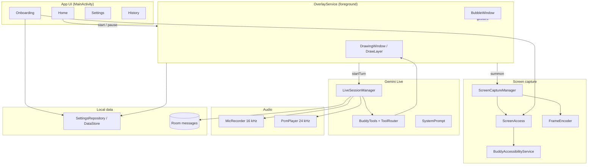
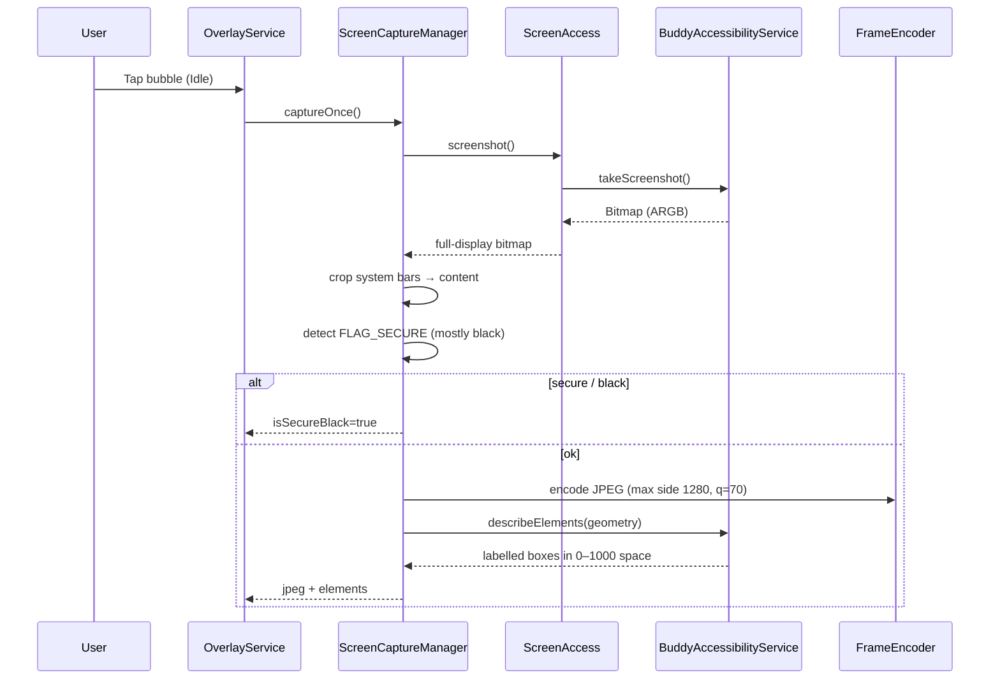
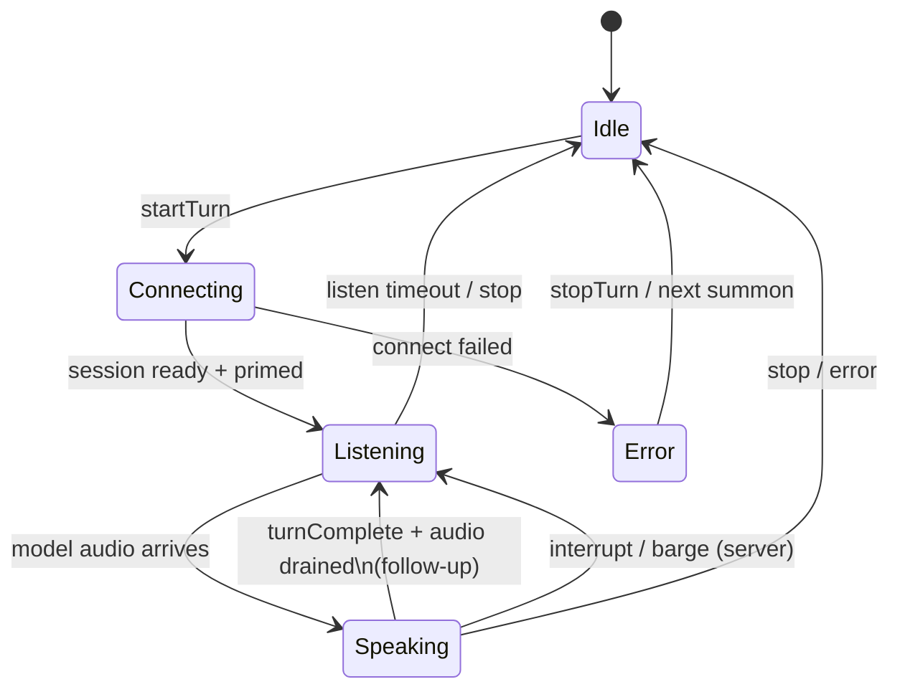
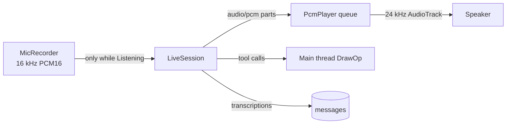

# ScreenBuddy (Buddy) — Architecture

This document describes how the Android app is structured and how a summon → answer → follow-up flow actually runs. It reflects the current codebase under `app/src/main/java/com/screen/buddy`.

| | |
|---|---|
| **Package** | `com.screen.buddy` |
| **minSdk / targetSdk** | 30 / 37 |
| **UI** | Jetpack Compose + Material 3 |
| **DI** | Hilt |
| **Live AI** | Firebase AI Logic → Gemini Live (Google AI backend) |
| **Screen access** | Accessibility Service (`takeScreenshot` + node tree) — not MediaProjection |

Related docs: [`AGENT_SPEC.md`](../AGENT_SPEC.md) (original product brief), [`FIREBASE_SETUP.md`](FIREBASE_SETUP.md).

---

## 1. What Buddy is

Buddy is a floating overlay tutor:

1. The user taps a bubble that floats over other apps.
2. Buddy captures the current screen (and labelled UI boxes).
3. It opens a **Gemini Live** voice session, streams the mic, and plays spoken answers.
4. The model can call drawing tools; marks appear on a full-screen, non-touchable overlay while Buddy talks.
5. After each answer the mic reopens for follow-ups without another tap (until a quiet timeout).

It does **not** tap, type, or control other apps. Screenshots are sent to Gemini for the answer and are not stored in Room (only text transcripts are).

---

## 2. High-level architecture



**Mental model:** Compose screens configure and launch the overlay. The overlay owns the conversation. Capture and Live are singletons shared via Hilt. Drawing state is a singleton `StateFlow` that the drawing window observes.

---

## 3. Package map

```
com.screen.buddy
├── BuddyApplication          # Hilt, Timber, Firebase, App Check
├── MainActivity              # NavHost: onboarding | home | settings | history | debug
├── di/AppModule              # Room database + MessageDao
├── capture/                  # How Buddy sees the screen
│   ├── BuddyAccessibilityService
│   ├── ScreenAccess
│   ├── ScreenCaptureManager
│   └── FrameEncoder
├── overlay/                  # Floating UX
│   ├── OverlayService
│   ├── BubbleWindow / BubbleGesture
│   ├── DrawingWindow / DrawingState / CoordMath
│   ├── OverlayLifecycleOwner
│   ├── draw/DrawLayer
│   └── math/Expr             # On-device formula sampling for charts
├── live/                     # Gemini conversation
│   ├── LiveSessionManager
│   ├── SessionState
│   ├── SystemPrompt
│   ├── BuddyTools            # Function schemas
│   ├── ToolRouter            # Schema → DrawOp
│   └── ImageGenerator        # show_image tool
├── audio/
│   ├── MicRecorder
│   └── PcmPlayer
├── data/
│   ├── SettingsRepository
│   └── db/                   # MessageEntity, MessageDao, BuddyDatabase
├── ui/                       # home, onboarding, settings, history, debug, theme
└── security/                 # AppCheckInstaller (debug vs release source sets)
```

---

## 4. Process and lifecycle

### 4.1 Cold start

1. `BuddyApplication.onCreate` installs App Check, initializes Firebase, plants Timber (debug).
2. `MainActivity` reads `SettingsRepository.onboardingDone`.
3. If false → `OnboardingScreen`; else → `HomeScreen`.

### 4.2 Onboarding (required grants)

| Step | Mechanism |
|------|-----------|
| Display over other apps | `Settings.ACTION_MANAGE_OVERLAY_PERMISSION` |
| Microphone | Runtime `RECORD_AUDIO` |
| Notifications (API 33+) | Runtime `POST_NOTIFICATIONS` |
| Screen access | User enables `BuddyAccessibilityService` in system Accessibility settings |

When all are granted and the user taps **Continue**, onboarding is marked done and `OverlayService.start()` runs.

### 4.3 Overlay service

`OverlayService` is a sticky foreground service with type **`microphone`** only (no MediaProjection FGS type).

On create it:

- Starts the persistent “Buddy is ready” notification (Pause / Quit actions).
- Creates an `OverlayLifecycleOwner` so Compose can run in system windows.
- Shows **DrawingWindow** (under) then **BubbleWindow** (on top).
- Observes gestures, pause flag, and drawing ops (to `bringToFront` the board).

Destroy closes the Live session, removes windows, and cancels coroutine scopes.

---

## 5. Screen capture (Accessibility)

Buddy does **not** use MediaProjection / “Share screen”. Capture is on-demand through the accessibility service.



### Geometry and coordinates

The model and tools use **integers 0–1000** over the **cropped content** region (status bar / cutout / nav bar removed).

`CaptureGeometry` stores:

- Full display size
- Content offset and size

`DrawLayer` maps `(nx, ny)` → pixels as:

`px = contentOffset + (n / 1000) * contentSize`

So rings land on the same place the model “sees” in the screenshot.

### Element list

`describeElements` walks the accessibility node tree (visible, non-password, labelled nodes) and emits lines like:

```text
"Settings" (tappable) [120,40,880,110]
```

Those boxes are preferred over guessing from pixels when pointing.

### Rate limits

Android rate-limits `takeScreenshot`. `ScreenAccess` retries a few times with a short delay when the interval is too short.

---

## 6. Overlay UX

### Bubble (`BubbleWindow`)

- System overlay, ~56dp, draggable; snaps to the nearest horizontal edge after a drag.
- Touch: short press → `Tap`; press ≥ ~280ms → `HoldStart` (and `HoldEnd` on release).
- Colour / pulse reflects `SessionState` (idle, connecting, listening, thinking, speaking, error).

### Gesture → action (`OverlayService`)

Both tap and hold-start call the same handler (continuous conversation; no push-to-talk from the overlay):

| Current state | Action |
|---------------|--------|
| Idle / Error | Summon: capture + `startTurn(pushToTalk = false)` |
| Speaking / Thinking | `interrupt` — stop voice, keep board, listen again |
| Listening / Connecting | End conversation + clear board |

### Drawing window (`DrawingWindow`)

- Full-screen, `FLAG_NOT_TOUCHABLE` (touches pass through to the app underneath).
- Hosts `DrawLayer`, which observes `DrawingState.ops`.

---

## 7. Live session (`LiveSessionManager`)

This is the core of the product: one long-lived Gemini Live conversation with tools and audio.

### 7.1 Models and config

| | Value |
|---|--------|
| Primary Live model | `gemini-3.1-flash-live-preview` |
| Fallback Live model | `gemini-2.5-flash-native-audio-preview-12-2025` |
| Backend | `GenerativeBackend.googleAI()` |
| Response modality | Audio |
| Transcriptions | Input + output enabled |
| Context | Sliding-window compression (needed for audio + images) |
| Tools | `BuddyTools.tool` |
| System instruction | `SystemPrompt.TEXT` (+ language hint, optional history seed) |
| Image tool models | `gemini-3.1-flash-image`, then `gemini-3.1-flash-lite-image` |

### 7.2 Important timers

| Constant | Default | Meaning |
|----------|---------|---------|
| `LISTEN_TIMEOUT_MS` | 45s | Silence while listening → end conversation |
| `WARM_SESSION_MS` | 90s | Keep WebSocket after idle for instant follow-ups |
| `FRAME_INTERVAL_MS` | 3s | Re-send screenshot while listening if the screen changed |
| `HANDLE_MAX_AGE_MS` | ~100 min | How long a server resume handle is trusted |
| `BOARD_LINGER_MS` | 90s | How long drawings stay after a conversation ends |
| `DRAW_STAGGER_MS` | 90ms | Delay between applying several tools in one burst |
| History seed | 12 msgs / 24h | Seed a brand-new session when resume is unavailable |

### 7.3 Session state machine



`Thinking` exists for push-to-talk (`endUserTurn`); the overlay does not use PTT today, so that path is mostly unused.

### 7.4 Connect strategy (`openAndPrime`)

1. **Reuse warm session** if the socket is still open → re-prime with a fresh screenshot.
2. Else try **session resumption** with the last server handle (same model).
3. Else connect **primary** model (system prompt may include Room history).
4. Else connect **fallback** model.

Receive loop runs on `Dispatchers.IO` (`live.receive().collect { … }`).

### 7.5 Priming a turn

On summon (and when refreshing):

1. If the frame is secure-black → send a text turn telling the model to say it cannot see the app.
2. Else `sendVideoRealtime(JPEG)` + a short text nudge to use `point_at` / `highlight_box`, optionally appending the element box list.

While **listening**, every ~3s Buddy may send a new frame if the JPEG hash changed, and (if the user has been quiet ~2s) an updated element list.

### 7.6 Audio paths



- **Uplink muted while Speaking** so speaker bleed does not false-trigger the model.
- **Playback** is a dedicated queue/thread (`PcmPlayer`) so the receive collector never blocks on `AudioTrack.write`.
- **Interrupt / stop** bumps a generation counter and flushes the queue.

### 7.7 Tool calls and live drawing

Gemini 3.1 Flash Live uses **synchronous** function calling: the model pauses generation, sends tools, waits for results, then continues speaking.

`handleToolCall`:

1. `ToolRouter.plan` validates args and builds an `apply` lambda (and a JSON result).
2. `sendFunctionResponse` immediately (so speech can continue).
3. `apply` is posted on the **main handler**, staggered by `DRAW_STAGGER_MS`.

So marks appear **as the model reaches that step**, not after the whole answer — matching “draw while explaining.”

### 7.8 Context across turns

| Mechanism | When |
|-----------|------|
| Same Live socket | Follow-ups while the conversation is active; warm reuse within 90s |
| Server resume handle | After reconnect, if handle is still valid |
| Room transcript seed | New session with no usable handle — last 12 messages (24h) injected into the system instruction |

Transcripts come from Live **audio transcription** fields (user + assistant text), not from raw PCM.

### 7.9 Ending a conversation (`goIdle`)

Stops the mic, stops playback, saves any pending transcript text. Optionally:

- Keeps the socket warm (stop receiving, close after 90s), or
- Force-closes if mid-generation / awaiting reply / GoAway / explicit close.

Pointer marks fade by TTL; the full board can linger via `DrawingState.clearAfter`.

---

## 8. Drawing system

### 8.1 Data model

`DrawingState` holds `StateFlow<List<Drawn>>` where each `Drawn` has an id, a `DrawOp`, and a creation timestamp (for entrance animation).

**Pointers** (auto-remove after settings TTL, default 8s):

- `Ring` — point at a spot  
- `HighlightBox` — outline a region  

**Whiteboard** (stay until `erase` / `clear_drawings` / linger clear):

| Op | Purpose |
|----|---------|
| `TextMark` | Equations, steps |
| `Arrow`, `Polyline`, `Shape` | Sketches / geometry |
| `Plot` | 2D charts (axes, grid, series) |
| `Surface3D` | `z = f(x,y)` mesh (rotating) |
| `Solid3D` | Cube, sphere, cylinder, cone, … |
| `Diagram` | Boxes + arrows (auto layout) |
| `NeuralNet` | Layered neuron diagram |
| `Picture` | Async generated illustration |
| `Wireframe` | Custom polylines |

Colours: named palette (`Palette`) plus `#RRGGBB`.

### 8.2 Tool surface (`BuddyTools` → `ToolRouter`)

Declared tools include: `point_at`, `highlight_box`, `draw_arrow`, `draw_text`, `draw_path`, `draw_shape`, `plot_function`, `plot_points`, `draw_3d_surface`, `draw_3d_shape`, `draw_diagram`, `draw_neural_network`, `show_image`, `draw_wireframe`, `erase`, `clear_drawings`.

- **`plot_function`**: expression parsed on-device by `Expr`, sampled into a `Plot`.
- **`show_image`**: `ImageGenerator` calls an image model asynchronously; UI shows a placeholder then swaps in the bitmap.
- Legacy alias **`draw_plot`** is still accepted in the router.

### 8.3 Rendering (`DrawLayer`)

One Compose `Canvas` draws all ops with entrance animations (traced strokes, typed text, staggered diagram nodes). 3D solids/surfaces keep animating (slow turntable).

---

## 9. Data layer

### Room (`buddy.db`)

`MessageEntity`: `role` (`user` / `assistant`), `text`, `createdAtEpochMs`.  
**No images.** Used by History UI, Settings “clear history”, and Live history seeding.

### DataStore (`buddy_settings`)

| Key | Role |
|-----|------|
| `onboarding_done` | Nav gate |
| `input_mode` | TAP / HOLD (settings UI; overlay currently treats both as start/stop) |
| `voice` | Live speech voice name |
| `language_hint` | Appended to system prompt |
| `drawing_duration_sec` | Pointer mark TTL (3–30s) |
| `paused` | Overlay ignores gestures when true |
| `battery_hint_shown` | OEM battery dialog |

---

## 10. Dependency injection

Hilt `@Singleton` types (constructor inject):  
`LiveSessionManager`, `ToolRouter`, `ImageGenerator`, `DrawingState`, `ScreenCaptureManager`, `ScreenAccess`, `FrameEncoder`, `MicRecorder`, `PcmPlayer`, `SettingsRepository`.

`AppModule` provides `BuddyDatabase` and `MessageDao`.

`@AndroidEntryPoint`: `MainActivity`, `OverlayService`, `BuddyAccessibilityService`.  
ViewModels are `@HiltViewModel`.

---

## 11. Security and networking

- **App Check**: debug builds use the Debug provider; release uses Play Integrity (`security/AppCheckInstaller` per source set).
- **Firebase**: `google-services.json` is gitignored; see `docs/FIREBASE_SETUP.md`.
- Screenshots leave the device only as Live realtime video frames / image-tool prompts — not written to Room.
- Accessibility description in resources states read-only screenshot + labels on summon.

---

## 12. End-to-end journeys

### First run

Onboarding → enable overlay, mic, notifications, accessibility → Continue → bubble appears.

### Summon → answer → follow-up

1. Tap bubble while Idle.  
2. Screenshot (+ elements) → Live connect/reuse → Listening.  
3. User speaks; 16 kHz audio streams up.  
4. Model speaks (24 kHz) and may emit tool calls → board updates immediately.  
5. `turnComplete` → transcripts saved → after audio drains → Listening again.  
6. User asks a follow-up **without tapping**.  
7. After ~45s silence → Idle; socket may stay warm ~90s; board may linger ~90s.

### Interrupt

Tap while Speaking → stop voice, keep drawings, listen again.

### Pause / Quit

Notification Pause → `closeWarmSession` + DataStore paused.  
Quit → stop the service.

---

## 13. Notable implementation details / gaps

These are useful when debugging or extending the app:

1. **Capture is accessibility-only.** Older `AGENT_SPEC.md` text about MediaProjection describes an earlier plan, not the current code.
2. **Drawings apply on tool arrival** (main thread + stagger). Cue-word / `PcmPlayer.runAtFrame` sync was removed because it delayed marks until end of turn.
3. **`endUserTurn` (push-to-talk)** exists on `LiveSessionManager` but the overlay always summons with `pushToTalk = false` and ignores `HoldEnd`.
4. **Settings `InputMode`** is stored and shown; overlay gesture routing does not branch on it anymore (both modes start/stop the same continuous conversation).
5. **Auth not registered / attributionTag** log lines from Firebase / AppOps are generally benign noise during development.

---

## 14. Where to change what

| Goal | Start here |
|------|------------|
| Prompt / teaching behaviour | `live/SystemPrompt.kt` |
| New drawing tool | `BuddyTools.kt` + `ToolRouter.kt` + `DrawOp` + `DrawLayer.kt` |
| Live connect / follow-ups / timeouts | `live/LiveSessionManager.kt` |
| Bubble / summon UX | `overlay/OverlayService.kt`, `BubbleWindow.kt` |
| Capture / pointing accuracy | `capture/*`, geometry in `ScreenCaptureManager` |
| Playback quality | `audio/PcmPlayer.kt` |
| Mic quality | `audio/MicRecorder.kt` |
| Permissions / first-run | `ui/onboarding/*`, `AndroidManifest.xml`, `res/xml/buddy_accessibility.xml` |
| Persistence | `data/SettingsRepository.kt`, `data/db/*` |

---

*Generated from the ScreenBuddy codebase as of the accessibility-capture + continuous Live conversation design.*
